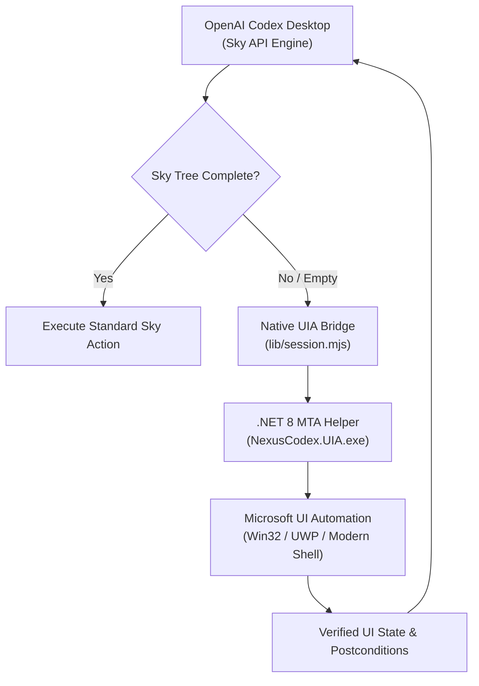

<div align="center">

# Codex Windows Computer Use

### Native Windows UI Automation & Computer Use Extension for OpenAI Codex Desktop

[](https://openai.com)
[](tests)
[](LICENSE)
[](https://github.com/pironjulien/codex-windows-computer-use/stargazers)

<p align="center">
  A high-performance Windows OS UI Automation layer designed to complement OpenAI Codex's built-in Computer Use engine over Sky API. Provides robust accessibility tree inspection, verified postconditions, and zero focus hijacking.
</p>

</div>

---

## Overview

**Codex Windows Computer Use** provides an enterprise-grade accessibility and OS automation extension specifically engineered for **OpenAI Codex Desktop**.

While OpenAI Codex natively handles screenshots, cursor movements, and basic keyboard actions, its accessibility tree inspection on Windows can encounter incomplete or empty hierarchies in complex Win32, UWP, and modern desktop apps. This extension seamlessly intervenes when Sky returns an empty or partial tree (`observe({backend: 'native'})`), leveraging official Microsoft UI Automation (UIA) APIs via a lightweight C# helper running on an isolated MTA thread (.NET 8).

### Key Architectural Strengths

- **Reliable Fallback**: The native UIA engine activates automatically when upstream Sky returns an empty tree, or explicitly via `observe({backend: 'native'})` to inspect deep control hierarchies.
- **Isolated MTA Process**: The .NET helper runs on a dedicated MTA thread in a reusable, monitored worker process. Messages are correlated, concurrent requests are rejected, and workers cleanly shut down after 30 seconds of inactivity or on timeout.
- **Zero Focus Hijacking**: Actions strictly target validated control identities. Text typing verifies keyboard focus before sending input, and sensitive password fields are safely rejected.
- **Deterministic Postconditions**: Every action verifies its expected transition (e.g. state change, visibility, selection) before declaring success. No blind retries or silent failures.
- **Application Memory**: Caches verified semantic action recipes without retraining or hardcoding pixel coordinates. If an application updates or moves controls, structural fingerprinting immediately invalidates stale recipes and forces fresh inspection.

---

## Architecture



---

## Testing & Validation

The codebase comes with a comprehensive suite of **59 unit and integration tests** testing edge cases including worker timeouts, corrupted metadata, structural changes, and focus guards:

```powershell
# Run the complete test suite
pwsh -NoProfile -File test.ps1
```

```text
✔ 59 tests passing in ~950ms
✔ 0 suites failed
✔ 0 flaky assertions
```

---

## Repository Structure

| Path | Purpose |
| :--- | :--- |
| [`lib/`](lib) | Core JavaScript runtime modules: session coordinator, native IPC transport, observation tree parser, and memory store. |
| [`native/`](native) | C# .NET 8 UI Automation helper source code (`Program.cs`, `NexusCodex.UIA.csproj`). |
| [`skill/`](skill) | Codex integration skill definition and API documentation. |
| [`tests/`](tests) | 59 deterministic unit and integration test fixtures. |
| [`VALIDATION.md`](VALIDATION.md) | Exhaustive technical validation protocol and test report. |

---

## License

This project is licensed under the **[MIT License](LICENSE)**.
