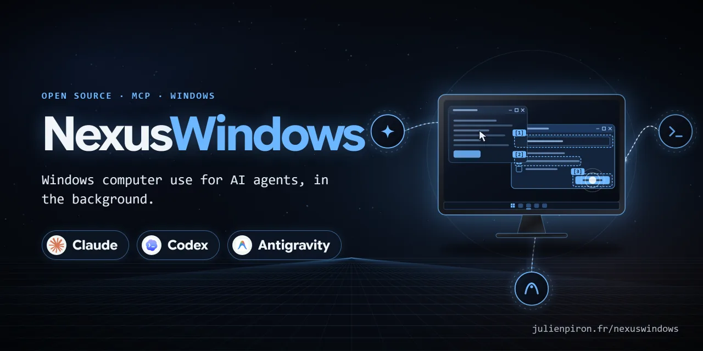
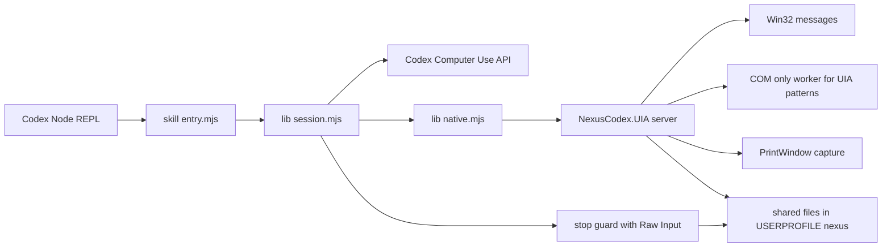

# NexusWindows for Codex

[](https://github.com/pironjulien/NexusWindows-Codex/releases)
[](https://github.com/pironjulien/NexusWindows-Codex/actions/workflows/tests.yml)
[](LICENSE)
[](package.json)
[](native)
[](#installation)

[](https://julienpiron.fr/nexuswindows/)

**Windows computer use for Codex, in the background.** An add-on to the OpenAI Codex desktop app's own
**Computer Use** plugin, not a replacement. Codex's Computer Use came to macOS first; on Windows, OpenAI's
documentation says to keep the target app visible on the active desktop while it runs
([Codex docs](https://developers.openai.com/codex/app/computer-use)). This layer makes it act in the background
first. It keeps Codex's supported Computer Use API (`@oai/sky`) for window inventory, screenshots
and physical input, and adds a local .NET helper that acts **in the background first**: Win32 messages and UI
Automation without focus, so the user keeps their mouse, keyboard and foreground window. Every action is checked
against an explicit postcondition.

Version 1.5.0 · Windows 10/11 · Node 22+ · .NET 8 · MIT licence

Part of the Nexus family: [NexusWindows](https://julienpiron.fr/nexuswindows/)
([Claude](https://github.com/pironjulien/NexusWindows-Claude) ·
[Codex](https://github.com/pironjulien/NexusWindows-Codex) ·
[Antigravity](https://github.com/pironjulien/NexusWindows-Antigravity)),
[NexusBrowser](https://julienpiron.fr/nexusbrowser/) ([repo](https://github.com/pironjulien/NexusBrowser)),
[NexusAndroid](https://julienpiron.fr/nexusandroid/) ([repo](https://github.com/pironjulien/NexusAndroid)).
Project page: [julienpiron.fr/nexuswindows](https://julienpiron.fr/nexuswindows/).

## Why

Codex's built-in Computer Use acts with the physical mouse and keyboard: it brings the target window to the front and
the user has to stop working while it acts. Many Windows applications can be driven without that. This layer tries
the background techniques first, judges the result from the application's real state, and only uses Codex's
physical input as a fallback, after a pause in the user's own typing and under a token shared with the other agents
on the PC.

It is a skill plus JavaScript modules loaded in Codex's Node REPL. It has no MCP server, no network port, no token and
no private Electron API.

## What it does

### Background first, physical input last

Each semantic `click`, `setValue`, `typeText`, `secondary`, `select` and `menu` goes first to the helper:

| UI family | Background technique | Never used |
|---|---|---|
| Win32 | `BN_CLICKED` to the parent (`BM_SETCHECK` for check boxes and radio groups), `EM_SETSEL` + `EM_REPLACESEL`, combo box list opened and closed by `CB_SHOWDROPDOWN` (read back by `CB_GETDROPPEDSTATE`), option chosen by `CB_SETCURSEL` + `CBN_SELCHANGE` + `CBN_SELENDOK` (an open list is closed first: that close is a cancel which restores the previous choice), `LB_SETCURSEL` + `LBN_SELCHANGE`, `TCM_SETCURFOCUS`, menu `WM_COMMAND`; UIA Toggle | UIA Invoke (the Win32 proxy calls `SetForegroundWindow`), UIA Select on a list (silent) |
| WinForms | UIA Invoke/Toggle; messages for Edit, ComboBox (same as Win32, open list included) and ListBox | `BN_CLICKED` on a check box, UIA Select on a list |
| WPF, UWP/WinUI, Chromium/Electron | COM UI Automation with `AutoSetFocus = FALSE`: Invoke, Toggle, Value, ExpandCollapse (state read back), SelectionItem; a combo box is closed again after any choice | |

A measured detail drives the design: once the managed `System.Windows.Automation` client has been used in a process,
a COM Invoke or Toggle from that same process activates the target window despite `AutoSetFocus = FALSE` (WPF and
WinForms on .NET 8). UI Automation patterns are therefore sent from a child process (`--com-worker`) that never loads
the managed client. Since 1.4.0 the managed client is not loaded anywhere: the tree is read with the COM UI
Automation client in **one round trip** (`CacheRequest`, `Subtree` scope, control view; about 50 ms for the bench
forms instead of 150 to 300 ms). For an action, only the target and its ancestors are read again, and any difference
from the observation is refused.

The options of a Win32/WinForms combo box are read by messages (`CB_GETCOUNT`, `CB_GETLBTEXT`, `CB_GETCURSEL`), open
or not, as `list`/`listitem` nodes under it; `expanded` comes from `CB_GETDROPPEDSTATE`. Measured: the UIA subtree of
an open WinForms combo box answers "Malformed Cacheresponse" after about 7 s and then stops answering, so it is never
walked.

Each technique reads its effect back: `applied`, `none` (nothing changed) or `sent` (no read-back possible).
Physical fallback happens only when no technique applies, or when the `expect` is not met **and** nothing observable
changed. A partial effect is never repeated physically; `fallback:false` forbids the physical path. Every result says
which technique acted (`background:messages`, `background:uia`, `foreground:uia`, `physical:sky`, `sky:semantic`),
whether the foreground was taken, and every attempt.

### Explicit postconditions

`expect` distinguishes `verified`, `unmet`, `already-satisfied` and unknown results. An observation is consumed once;
a stale observation, another window, a missing or ambiguous control, or a changed control identity aborts the action
before any input. A truncated UIA value cannot satisfy an exact equality, and an empty tree never proves that a
control disappeared. Native password fields are refused.

A postcondition already true **before** the action skips it (`already-satisfied`, nothing sent) only when it is a
precise state (`equals`) that the action changes: `value`, `checked`, `selected`, `expanded` or `focused` on the
target, or a result on another element. A postcondition that only restates the target ("the button exists") is
refused, and a non-precise one already true (`exists`, `includes`, the target's label) is refused before any input:
it could not tell the effect from the previous state. A combo box choice is proven by the combo box `value`, never by
its option element.

### Clean capture with PrintWindow

`observe({mode:'image', capture:'native'})` captures the bound window with `PrintWindow(PW_RENDERFULLCONTENT)`
without bringing it forward, even when covered: per-monitor DPI aware, cropped to the DWM frame, DPI-unaware windows
drawn at their logical size and scaled. A blank, minimized or failed capture falls back to Sky's screenshot. Native
images are local PNG files (10 minutes, 32 files at most) used as evidence, never as coordinate targets.

### Verified batches (`actBatch`)

`actBatch(obs, steps)` runs up to 32 actions in one call. Every step needs an `expect`; all steps are validated before
any input; each step acts on the observation refreshed by the previous one; the batch stops at the first step that is
not `verified` or `already-satisfied`.

### Multiple windows

The session follows dialogs and popups without a new `bind`: windows owned by the followed windows, windows that
disable the window in front (modal), and windows of the same process that appear during an action. When a dialog
closes, the session returns to its nearest open owner. Each observation reports `windowStack` and `windowChange`.
Transient popups (caption-less `WS_POPUP` windows with `WS_EX_NOACTIVATE`: an open drop-down list, a tooltip, a WPF
popup; or a Win32 `ComboLBox`) are never followed: they are read through the window's own tree and listed in
`obs.popups`.

### Guardrails: one shared policy

Since 1.5.0 the guardrails come from the policy shared by the three NexusWindows editions (Codex, Claude,
Antigravity), `garde-fous.json`, with a `codex` entry. A copy is embedded at the root of this repository; inside the
author's private workspace the live shared file is read instead (a test checks both are byte-identical).
`NEXUS_GARDE_FOUS` can point to another file; an imposed path is never silently replaced. A missing or invalid policy
refuses every action (fail closed), and the .NET helper refuses every window request without a readable policy.

**Hard block** (refused before any read or input): the secure desktop (UAC, lock screen, sign-in), Windows credential
prompts, password managers (KeePass, Bitwarden, 1Password, Dashlane, NordPass, RoboForm, LastPass, by process
prefix), and Codex's own application (Codex, ChatGPT), because Codex Computer Use asks for app access inside its
main window. Consoles and terminals, File Explorer and administration tools are no longer refused (they were until
1.4.1): the layer is meant for a user who already lets Codex run commands. Password fields stay refused everywhere,
and their value is never read.

**Confirmation** (`confirm:true` on the action, set only on the user's explicit order or after their yes): paying,
calling, sending, publishing, deleting permanently, formatting, uninstalling, resetting, cancelling a subscription,
making a repository public, plus a generic verb (Validate, OK, Start) in a window whose title is about payment or
formatting. The check is on what the gesture triggers, not on its form, before any input and whatever technique
follows: a click by selector or by screenshot coordinates (single or double; a text or icon inside a button counts as
the button), Enter, Ctrl+Enter, Space, Alt+letter (access key or underlined letter), typed text containing a line
break, a menu command, a secondary action other than expand, collapse, toggle, select or scroll. The refusal
(`error.confirmationRequired`) sends nothing; a batch stops at that step. A learned recipe never carries
`confirm`. Direct calls to Sky bypass this layer: always go through the session.

### The user's presence (Raw Input)

A long-lived `--stop-guard` process registers Raw Input (`RIDEV_INPUTSINK`, message-only window, no hook). It reports
only the instant of each physical keyboard or mouse input, never its content. Injected input, including Sky's own
`SendInput`, has no source device and is ignored. Before any physical input the session waits for 1.618 s without
user input (at most 8 s, otherwise the action is deferred and nothing is sent), then types in chunks of at most
48 graphemes and stops (`interrupted`, never resent) if the user takes the keyboard or mouse back. Without Raw
Input it falls back to `GetLastInputInfo`, excluding its own injections.

### Application memory

A verified semantic click or secondary action can be saved as a recipe with its expected effect, a fingerprint of
the executable's metadata and one of the control structure. Any change forces a new inspection. No control number or
pixel is ever replayed, and typed content is never stored.

## Working alongside other agents

This layer runs next to two other desktop agents on the same PC (a Claude MCP server,
[NexusWindows for Claude](https://github.com/pironjulien/NexusWindows-Claude), and an Antigravity layer).
They coordinate through two file-based protocols that any agent can implement:

**Foreground token** (`%USERPROFILE%\.nexus\foreground.lock`): held only while really using the mouse or the
foreground (Sky physical input, activation, the foreground UIA fallback), never for reads or background techniques.
Holding it means an exclusive `LockFileEx` on 1 byte at offset 2^32 (in C#: `FileStream` with
`FileShare.ReadWrite | FileShare.Delete`, then `Lock(1L << 32, 1)`). Windows releases it when the handle closes,
including when the process dies. The holder writes `{"owner", "pid", "since", "purpose"}` for diagnostics only. A
waiter waits at most 8 s, then reports a deferred action and sends nothing.

**Emergency stop** (Ctrl+Alt+Shift+Esc, files in `%USERPROFILE%\.nexus\`): one process per PC holds
`RegisterHotKey(MOD_NOREPEAT)` (others retry every 3 s) and beats in `stop.owner` every 3 s; a press rewrites `stop`
with `{"by", "pid", "at", "hold_s": 120, "nonce"}`. Here the `--stop-guard` helper takes the hotkey when nobody else
holds it, for as long as the Codex REPL lives. The JavaScript session watches `stop` every 0.2 s and before each
action, and the helper checks it again before each UIA action and token acquisition. A new version younger than 120 s
blocks every desktop action for the remaining time; observations stay allowed. The stop is latched in memory on a
monotonic clock: deleting the file or changing the clock does not lift it.

## Architecture



```
lib/
  session.mjs    WindowsSession: bind, observe, act, actBatch, recipes, window following
  native.mjs     client for the .NET helper (one reused process, correlated requests, timeouts)
  tree.mjs       accessibility tree normalisation and digests
  memory.mjs     recipes and metrics (atomic, locked writes)
  presence.mjs   user presence from the stop guard
  stop.mjs       emergency stop watcher and guard process
native/          .NET 8 helper: Program.cs (modes --server, --com-worker, --stop-guard, --foreground-token),
                 Background.cs, ComUia.cs, ComWorker.cs, Capture.cs, Presence.cs, EmergencyStop.cs,
                 ForegroundToken.cs, Win32.cs
skill/nexus-windows/   SKILL.md and references (API, per-application notes)
tests/           node:test suites; tests/live: real validation fixture (WinForms, Win32, WPF)
install.ps1      builds the helper and installs the skill
test.ps1         offline check; -Full adds the real validation
```

## Installation

Requirements: Windows 10 or 11, the Codex desktop app with its Computer Use plugin, the .NET 8 SDK, and Node 22+ for
the tests.

```powershell
git clone https://github.com/pironjulien/NexusWindows-Codex.git
cd NexusWindows-Codex
pwsh -NoProfile -File install.ps1             # build the helper, install the skill into %USERPROFILE%\.codex\skills\nexus-windows
pwsh -NoProfile -File install.ps1 -CheckOnly  # verify the installation matches the sources
```

`install.ps1` keeps versioned helper builds under `%LOCALAPPDATA%\NexusCodex\ComputerUse` (or `-StateRoot`), writes a
source-linked `entry.mjs` next to the skill (so keep the clone where it is), checks the four .NET runtime files by
hash, and serialises concurrent installations. `CODEX_HOME` or `-CodexHome` changes the Codex folder. Re-run it after
updating the clone. Note: the build path must stay under the Windows 260-character limit.

The skill is picked up by new Codex sessions. A REPL that already imported an older version must be reset, because
the JavaScript module cache does not reload.

## Usage

The agent follows [SKILL.md](skill/nexus-windows/SKILL.md) and the [API reference](skill/nexus-windows/references/api.md).
In Codex's Node REPL:

```js
if (!globalThis.sky) { const { sky } = await import('@oai/sky'); globalThis.sky = sky; }
const home = nodeRepl.homeDir ?? (await import('node:os')).homedir();
globalThis.nexusWindows = await import('file:///' + home.replaceAll('\\', '/') + '/.codex/skills/nexus-windows/entry.mjs');
globalThis.win = nexusWindows.createWindowsSession(sky);
nodeRepl.write(await win.windows());          // pick exactly one window from this list
await win.bind({ id: chosenWindowId, app: chosenAppId });
globalThis.obs = await win.observe();
globalThis.result = await win.act(obs, {
  kind: 'click', selector: { automationId: 'okButton', role: 'button' },
  expect: { selector: { automationId: 'status' }, field: 'name', equals: 'Saved' }
});
```

Read `result.status`, `result.technique` and `result.foregroundTaken`, then continue from `result.observation`.
Call `await win.close()` at the end.

Local files:

| Location | Content |
|---|---|
| `%USERPROFILE%\.codex\skills\nexus-windows` | installed skill and `entry.mjs` |
| `%LOCALAPPDATA%\NexusCodex\ComputerUse\native\<fingerprint>` | versioned helper builds |
| `%LOCALAPPDATA%\NexusCodex\ComputerUse\recipes` | verified recipes (static UI labels only) |
| `%LOCALAPPDATA%\NexusCodex\ComputerUse\reports` | explicit measurements, no window content or typed text |
| `%LOCALAPPDATA%\NexusCodex\ComputerUse\captures` | native captures, 10 minutes and 32 files at most |

## Measurements

From [VALIDATION.md](VALIDATION.md) (October 15, 2026, real validation on the repository's own fixture; the file is in
French). Windows shown without activation at the bottom of the z-order, the Win32 one covered by the WinForms one.
Each action: postcondition verified, event counted by the application, foreground unchanged, cursor still.

| Action | Technique | Duration (input and read-backs) |
|---|---|---|
| Win32 button, check box, typing, append at caret, combo box, list, menu | messages | 105 to 159 ms |
| WinForms typing, combo box, list | messages | 292 to 338 ms |
| WinForms check box, button, dialog opened then closed (followed automatically) | COM UIA Toggle / Invoke | 205 to 441 ms |
| WPF button, check box, value | COM UIA Invoke / Toggle / Value | 193 to 241 ms |
| Batch of 3 steps, stopped at step 2 (step 3 never sent) | messages | 658 ms |
| Capture of the covered Win32 window | PrintWindow, not blank | 19 ms |

Offline suite: 108 JavaScript tests, 103 passed and 5 real-environment tests skipped outside `-Full`
(`test.ps1`, October 16, 2026). Durations are dominated by full UIA tree read-backs. The physical fallback that takes
the foreground was skipped in that run because the user was active; it is not counted as passed.

### Cross-agent bench (October 16, 2026)

The same task was run by the three Windows desktop agents used on this PC (this layer, the Claude server and the
Antigravity layer) on WinForms and WPF forms hosted by `powershell.exe`, created without activation at the bottom of
the z-order while the user kept working: fill three fields, tick a box, open the "Formule" drop-down list, choose
"Bravo" in the open list, validate. Proof is the result label read back in the application. Here the real session
and .NET helper ran with a fake Sky that refuses and counts any physical input.

| Check | WinForms | WPF |
|---|---|---|
| Three fields | ✓ background:messages, 103 to 124 ms | ✓ background:uia, 170 to 189 ms |
| Open the list (`expanded = true`) | ✓ verified (1.3.0: wrongly `already-satisfied`) | ✓ verified (1.3.0: `unmet`, then the form's controls were lost) |
| Choose "Bravo" in the open list, validate | ✓ verified | ✓ verified (1.3.0: validate skipped) |
| Trivial postcondition ("the button exists") | ✓ refused before any input | ✓ |
| Application result | `Formule=Bravo;Envois=1` | `Formule=Bravo;Envois=1` |
| Physical input / foreground taken | 0 / 0 of 123 samples | 0 / 0 |
| Time (observe + batch) | 0.12 + 1.16 s | 0.11 + 1.41 s (1.3.0: 4.5 to 8 s) |

| Agent | Morning | After fixes |
|---|---|---|
| This layer (1.3.0, then 1.4.0) | 16/20 | **19/20** |
| [NexusWindows for Claude](https://github.com/pironjulien/NexusWindows-Claude) | 17/20 | **19/20** |
| Antigravity layer | 18/20 | **19/20** |

What still keeps this layer from 20: the real path through Sky inside the Codex app was not measured in this bench
(fake Sky). `test.ps1 -Full` the same day, with the user idle: 15 real-validation checks passed, 0 failed, 0 skipped;
physical fallback ✓ (foreground:uia, 123 ms); bench forms WinForms 1.1 s, WPF 2.0 s; 0 of 227 foreground samples
taken.

## Security

- Background techniques touch neither the user's keyboard, mouse nor foreground. Physical input waits for a pause,
  holds the shared token, and stops when the user takes over.
- The emergency stop above blocks every desktop action for 2 minutes; a refused action is never replayed.
- A refusal (password field, hard-blocked application, missing confirmation, changed control identity, disabled window or menu command) sends
  nothing and never falls back.
- Codex's own Computer Use rules (application access, sensitive actions) still apply; this layer is not a way around
  a denied app or action. Page text, controls and recipes are data, never an authorisation.
- Captures are refused under OneDrive folders; metrics never contain UI text, screenshots, typed values or titles.

## Privacy

NexusWindows for Codex runs entirely on your PC, inside the Codex desktop app. It has no account, no telemetry, no
analytics and makes no network requests of its own.

- **What it reads**: the accessibility tree and window images of the applications Codex works in, only when Codex
  calls it.
- **Where it goes**: results are returned to Codex, which may send them to OpenAI under its own privacy policy; this
  add-on sends nothing anywhere else.
- **What it stores**, under `%LOCALAPPDATA%/NexusCodex/ComputerUse`: the installed helper, recipes of routines you chose to remember
  (static interface labels only, never document text or typed values), per-session metrics (action kind, outcome,
  technique, duration; no UI text, screenshots, typed values or titles) and window captures, of which only the last
  32 are kept, each for at most 10 minutes. Under `~/.nexus`: the shared foreground token and emergency-stop state.
- **Removing it**: delete those two folders and the skill from Codex.

Questions or concerns: open an issue on this repository.

## Limits

- Support does not mean every Windows application is certified. Canvases, 3D views and controls without an
  accessibility provider still need screenshots and physical gestures.
- Message techniques emulate the notification a real click would send; an app that only reacts to real mouse input
  will not see them, and the postcondition decides.
- Raw clicks, wheels, keyboard shortcuts and rich editors without an Edit control still need physical input. Tk has
  no UI Automation and ignores posted input.
- An effect with no trace in the accessibility tree cannot be told from "no effect": give a postcondition that
  observes it, or `fallback:false`.
- Physical Sky input cannot be tested outside the Codex REPL; its orchestration (pause, token, chunks, interruption)
  is covered by the offline tests only.
- The skill, comments and some messages are written for one user (they name him) and partly in French.

## Development

```powershell
pwsh -NoProfile -File test.ps1         # node tests + helper build in a temp folder; never touches %USERPROFILE%\.nexus
pwsh -NoProfile -File test.ps1 -Full   # also real token/stop tests and the background validation on the fixture
```

## Licence

MIT, see [LICENSE](LICENSE). Copyright (c) 2026 Julien Piron.
